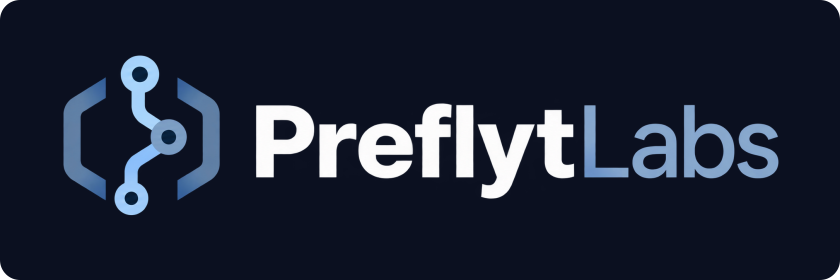
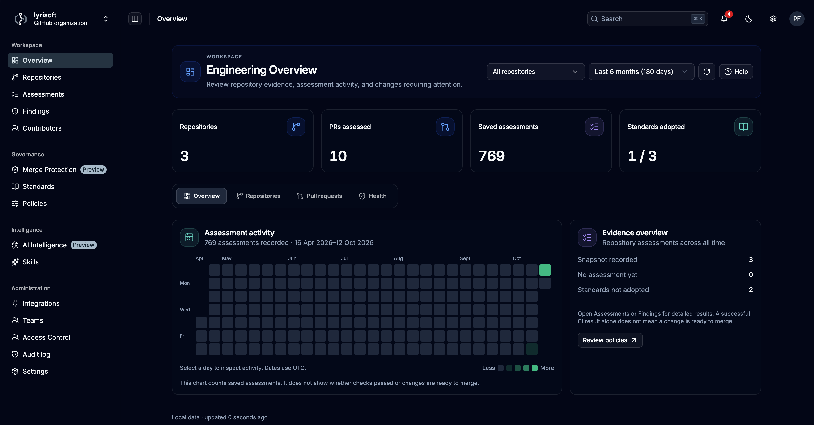

# Preflyt Community Edition

  

**Know what passed. See what needs attention.**

Open-source engineering assurance for GitHub. Self-host Community Edition under **Apache-2.0**.

Preflyt brings repository health, engineering standards and verified CI results into one self-hosted workspace. Understand the evidence behind every assessment, investigate findings at the assessed commit and see which required results are still missing.

Identify engineering risks early, verify that changes satisfy approved requirements, and give engineering leaders evidence they can review across repositories. A readiness result can pass, fail or remain incomplete; missing evidence never becomes a pass. The documented Compose installation includes the Health scanner. Continuous PR feedback requires the configured CI integration.

Developed by **Lyrisoft Technologies**.

[Documentation](https://docs.preflytlabs.com/) · [Getting started](https://docs.preflytlabs.com/getting-started) · [Self-hosting](https://docs.preflytlabs.com/self-hosting) · [Preflyt Action](https://github.com/lyrisoft/preflyt-action)

## The problem

Tests, scanners and CI pipelines produce useful results, but those results often live in separate tools. Teams still need to answer:

- Which engineering requirements apply to this repository and target branch?
- What security, reliability and maintainability issues exist in the codebase, even before CI is connected?
- Which findings need attention, where is the affected code, and what should we do next?
- Did the required checks run against the current commit?
- Is the evidence sufficient to establish a pass, or is something missing?
- What must a developer fix before the change can progress?
- Can the team explain the decision later?

Preflyt brings repository health, findings, standards, branch policies and developer feedback into one workflow. Developers get code context and practical guidance; engineering leads can prioritize repository risks and follow comparable assessment trends; platform teams can apply consistent requirements and trace the evidence behind each result. Existing CI pipelines continue running tests and publishing their results.

## How it works

1. **Connect GitHub.** Create or connect a GitHub App and select repositories during installation in GitHub. Preflyt imports those repositories automatically and preserves your original admin session; you do not select them again in Integrations.
2. **Read repository health.** Selection queues an assessment of the default branch. Review supported scanner findings, exact-revision source locations and report limits without setting up CI. The dedicated built-in scanner runs every applicable Health analyzer automatically; no extra repository approval is required.
3. **Define requirements.** Adopt versioned standards and publish a policy for the target branch. Development and main can have different requirements.
4. **Run checks in CI.** Install the Preflyt Action once in your GitHub Actions workflow. The published branch policy selects the configured commands and supported scanners. Preflyt receives their reports and verifies execution evidence for the exact commit and workflow attempt.
5. **Review the result.** Preflyt saves a commit-bound assessment and publishes **Preflyt / Engineering Readiness** on the pull request. Required checks can pass, fail or remain incomplete when evidence is insufficient.
6. **Optionally enforce the policy.** Require the check in GitHub, or explicitly activate Preflyt-managed merge protection. GitHub enforces whether a merge is allowed.

Repository inspection identifies configuration; it does not execute tests or prove that a check passed. Saving repository standards and publishing a branch policy are separate actions. Neither automatically enables merge protection.

## Community Edition

Community Edition is free and self-hosted, with **unlimited repositories** subject to your infrastructure capacity. It includes Health, standards and policies, CI evidence/PR feedback, basic merge protection, findings/history, access controls, audit and optional BYOK AI. No paid model is required for the deterministic assurance workflow. Managed Cloud is planned for later.

Install using the [Quick Start](https://docs.preflytlabs.com/getting-started/quick-start) with public GHCR container images. No subscription, license key or registry token is required.

## What Preflyt provides

| Capability | Purpose |
| --- | --- |
| **Repository health** | Assess selected branches for supported security, reliability, maintainability, duplication and infrastructure issues; view overall health, completeness, freshness and comparable report history. Built-in isolated scanners run automatically without per-repository approvals. |
| **Versioned standards** | Define engineering checks, reuse built-in packs, and adopt reviewed versions for repositories and teams. |
| **Branch policies** | Specify required checks for a target branch and preserve the approved policy revision. |
| **CI integration** | Receive GitHub workflow/check events and supported test and scanner reports, including JUnit and SARIF. |
| **Commit-bound assessments** | Show passing, failing and incomplete checks with the evidence used to evaluate them. |
| **PR feedback** | Publish readiness checks and optional actionable AI review comments where developers work. |
| **Merge protection** | Inspect GitHub rulesets and optionally manage activation, drift detection and rollback. |
| **Unified findings** | Investigate CI and repository-health findings in one worklist, filtered by source, type, repository, severity and status, with assessed-commit source excerpts where available. |
| **AI finding guidance** | Save concise problem, likely effect and suggested-fix explanations from assessed code. Use analyzer/rule guidance when AI is unavailable or unconfigured. |
| **Contributor visibility and audit history** | Review recorded repository, commit, PR and review activity alongside scoped audit records, without turning activity into an employee performance score. |
| **Teams and access control** | Apply standards across explicit repository scopes and manage organization roles and permissions. |
| **Self-hosting** | Run the application with Docker Compose or the Kubernetes application bundle, with backup and observability guidance. |

### Optional AI reviews

AI guidance explains individual findings using code from the assessed commit and saves the result for later visits. Configured AI is the primary explanation when a valid result is available; analyzer/rule guidance remains the fallback. Optional PR reviews use organization-selected models and review skills. Supported connections include OpenAI, Anthropic, Google, DeepSeek and OpenAI-compatible endpoints.

Code sharing is explicitly configured. AI findings are advisory: they do not change deterministic policy results, waive required checks or authorize a merge. When AI feedback is configured as part of a workflow, a provider or publication failure can still prevent that workflow from completing successfully.

### Optional native execution

Preflyt also includes an advanced path for running fixed checks in a separately reviewed Docker or Kubernetes sandbox. It requires dedicated isolation, trusted runtime/tool reviews and operator setup. Adapter coverage is limited, and production release acceptance is not complete.

Native execution is optional. It is not required for GitHub Actions integration. See the [native execution guide](https://docs.preflytlabs.com/user-guide/native-execution) before evaluating this path.

## Get started

The normal onboarding path is:

**Run Preflyt → connect an App and choose repositories in GitHub → repositories load → read Health.**

For continuous feedback: **review standards and workflow setup → merge the setup PR → receive PR results.**

- [Quick start](https://docs.preflytlabs.com/getting-started/quick-start): run a local evaluation instance.
- [Connect GitHub](https://docs.preflytlabs.com/getting-started/connect-github): guided App registration, installation and owner onboarding.
- [Pull request checks](https://docs.preflytlabs.com/user-guide/pull-request-checks): connect branch policies to your workflow.
- [Docker Compose](https://docs.preflytlabs.com/self-hosting/docker-compose) and [Kubernetes](https://docs.preflytlabs.com/self-hosting/kubernetes): deployment requirements and downloadable configuration.

One GitHub App supports repository access, PR reviews and check publication. Setup-PR writes and ruleset administration are optional permissions; a separate governance App is optional too. The public Preflyt Action uses short-lived GitHub OIDC authentication rather than a Preflyt API key. External report signatures are optional for the normal verified GitHub workflow path.

GitHub Actions and webhooks need a reachable HTTPS API endpoint. A localhost installation requires a tunnel for live integration. Application images are currently private on GHCR and require package pull access; the public Action does not grant that access.

## Architecture

Preflyt is a TypeScript monorepo managed with pnpm and Turborepo.

| Component | Location | Responsibility |
| --- | --- | --- |
| Web application | [`apps/web`](apps/web) | React workspace UI for repositories, standards, policies and results. |
| API and worker | [`apps/api`](apps/api) | NestJS API, authorization, GitHub integration, assessment processing and background jobs. |
| Documentation | [`apps/docs`](apps/docs) | Docusaurus user and self-hosting documentation. |
| Deployment assets | [`deploy`](deploy) | Container definitions, Kubernetes manifests and infrastructure configuration. |
| Engineering reference | [`docs`](docs) | Architecture decisions, operator runbooks, product contracts and acceptance records. |

PostgreSQL stores application data. Valkey/Redis supports background queues and caching. The API and worker share the application codebase; execution controllers are separate, optional deployment components.

## Project status

Preflyt is under active development. The GitHub workflow integration, standards, assessments, access control and guided App onboarding have focused test coverage and recorded live acceptance runs. That does not establish production qualification for every deployment or optional execution path.

Use the [acceptance records](docs/acceptance) and [operator runbooks](docs/operations) for the scope and limits of verified behavior. Kubernetes live-cluster acceptance and complete native execution release acceptance remain outstanding. The Kubernetes Operator is planned; the current bundle uses ordinary manifests.

## Feedback and security

Use [GitHub issues](https://github.com/lyrisoft/preflyt/issues) for product feedback and reproducible defects. Include the affected version, workflow or commit, expected behavior and sanitized diagnostics. Exclude credentials, private source code and sensitive report contents.

Contribute a standards/check improvement, supported CI report integration, scanner reproduction fixture or documentation correction. For an initial contribution, read [CONTRIBUTING.md](CONTRIBUTING.md), discuss the intended change in an issue and sign off each commit under the [DCO](DCO). Contributors retain ownership. Public contribution access opens with the Community release; current collaborators can participate now.

Report suspected vulnerabilities privately to **support@lyrisoft.tech** following [SECURITY.md](SECURITY.md). Read [SUPPORT.md](SUPPORT.md) for community help and [CONTRIBUTING.md](CONTRIBUTING.md) / [DCO](DCO) before contributing.

## Licensing

Original Preflyt Community Edition code and documentation are licensed under [Apache-2.0](LICENSE). Third-party code, assets and dependencies retain their own licenses; see [NOTICE](NOTICE) and [third-party notices](THIRD_PARTY_NOTICES.md). The separate [Preflyt Action](https://github.com/lyrisoft/preflyt-action) remains MIT-licensed. Names and logos do not imply trademark or endorsement rights.

The Docker Compose deployment includes the Health scanner, a separate TLS-protected scanner engine and automatic connection setup. Run the documented start command; no separate scanner installation is needed. See [Automatic Health scanner](docs/deployment/health-scanner/README.md) for the deployment boundaries and local source-development startup. API and worker never receive Docker authority.

Scanner licensing and release preparation are documented in [Scanner licensing](docs/operations/scanner-licensing.md), [dependency security patches](docs/operations/dependency-security-patches.md) and [repository launch preparation](docs/operations/community-repository-launch.md). Preflyt's Apache-2.0 license does not replace upstream licenses or grant rights to proprietary scanner components.

Planned repository-aware AI review with searchable code indexing and related-code retrieval outside the PR diff (issue #97 / P4.RI) is **Cloud-only**. Community Edition retains its existing profiles, Health/source evidence and optional BYOK diff-based reviews.

### Optional installation reporting

Installation reporting is enabled by default (opt-out), with a disclosure and switch in Settings → Configuration. Set `PREFLYT_INSTALLATION_REPORTING_ENABLED=false` before first startup to prevent reports. Only a random installation ID, version, deployment type and schema version are included. No report is sent until a receiver URL is configured. See [reporting details and receiver operations](docs/operations/installation-reporting.md).
