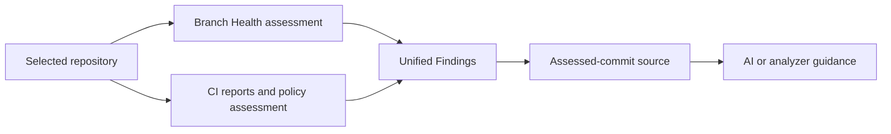
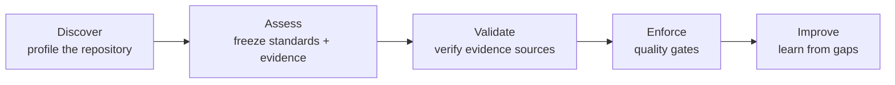

# How Preflyt works

Problems found in QA or production cost more than problems found while you design, code or review. Preflyt helps you catch them **earlier**, at your repository and your pull requests, by answering three questions at an exact commit:

1. **Which engineering checks apply** to this repository?
2. **What evidence** exists for each of them, and can you trust it?
3. **Is it ready** to progress, or where are the gaps?

Preflyt is an **open source engineering assurance platform for GitHub**. Self-host Community Edition under Apache-2.0. It connects repository health, approved requirements and verified evidence from tests and scanners. Your configured GitHub Actions integration provides continuous PR feedback; the built-in Health scanner runs applicable static checks in isolated containers. AI helps investigate and explain findings, while deterministic checks and approved policies own readiness evaluation. GitHub applies any explicitly configured merge restrictions.

Preflyt works with your CI and scanning tools. It does not replace GitHub Actions, established testing frameworks or comprehensive scanner products. Built-in scanners have explicit coverage limits; existing tools can supply supported reports through configured policy commands.

## Health before CI

Selecting a repository queues a branch Health assessment at a fixed commit. The built-in scanner produces located findings without a workflow, saved standards or additional approval. Source-access and scanner failures are shown with a reason and next steps. Partial analysis keeps its available findings and identifies the gaps. Health findings do not satisfy CI policy gates. See [Repository health](../user-guide/repository-health.md).

## The CI workflow

Health and CI answer complementary questions. **Health** describes the codebase at a selected branch revision, including supported findings, completeness and freshness. **CI assessments** establish whether submitted checks meet the requirements for a change. Both feed the same Findings workspace.

In Findings, filter by source, type, repository, severity or status. Open an issue to inspect its evidence and saved source excerpt. Configured AI produces a short problem, likely effect and suggested fix, saved for later visits; analyzer/rule guidance is the fallback. AI explanations are advisory. The original evidence remains available alongside them.

| Step | What Preflyt does | Status |
| --- | --- | --- |
| **Discover** | Profiles each selected repository with file evidence. | Available |
| **Assess** | Freezes your standards and reported CI results at a commit. | Available |
| **Validate** | Verifies where evidence came from, through authenticated submissions and verified GitHub execution, or reviewed native execution receipts. | Available, see [Evidence and trust](evidence-and-trust.md) |
| **Enforce** | Shows a merge review result for every report. A published policy publishes a **Preflyt / Engineering Readiness** check on each pull request. **Merge Protection** can require it through GitHub rulesets. | Observe by default; enforcement is opt-in |
| **Improve** | Trends, contributor activity and advisory AI review. | Available |

## The three engines

- **Validation**: discovers repository context, coordinates automatic isolated Health analysis and normalises CI evidence.
- **Governance**: holds your standards, requirements and quality gates.
- **Intelligence**: explains findings using assessed code and supports optional PR reviews. **AI never decides a gate result.**

## What "observe mode" means

In the default install, Preflyt **reads** and **records**:

- It reads repository files and metadata through a read-only GitHub App.
- It records CI results GitHub reports for exact commits.
- The built-in Health scanner runs static analysis. It does **not** run your repository tests, install dependencies or provision test services. **Your own GitHub Actions workflow** owns tests and coverage; Preflyt verifies submitted evidence. Optional native command execution has separate deployment controls; see [Native execution](../user-guide/native-execution.md).
- It does **not** block merges by default. Blocking needs three explicit steps: publish a policy, turn on PR checks, and require the **Preflyt / Engineering Readiness** check in GitHub. See [Pull request checks](../user-guide/pull-request-checks.md) and [Merge Protection](../user-guide/merge-protection.md).

A **Related files found** result means a supported file or workflow reference exists at that commit. It does **not** prove the tool ran or passed.

## Core objects

| Object | Meaning |
| --- | --- |
| **Workspace** | Your organization's space in Preflyt, linked to a GitHub organization or identity provider. |
| **Repository** | A GitHub repository you have explicitly selected. |
| **Profile** | What Preflyt found in a repository at one commit. |
| **Standard** | A versioned set of engineering checks, such as Application Security. |
| **Health report** | Immutable branch analysis, supported findings, completeness and freshness; separate from CI readiness. |
| **Report** (CI assessment) | A saved snapshot of selected standards and evidence at one commit, with a merge review result. |
| **CI result** | A check or workflow outcome GitHub reported for a commit. |
| **Finding** | An issue surfaced from evidence, with its own lifecycle. |
