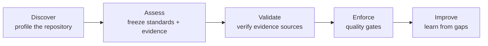

# How Preflyt works

Problems found in QA or production cost more than problems found while you design, code or review. Preflyt helps you catch them **earlier**, at your repository and your pull requests, by answering three questions at an exact commit:

1. **Which engineering checks apply** to this repository?
2. **What evidence** exists for each of them, and can you trust it?
3. **Is it ready** to progress, or where are the gaps?

Preflyt coordinates the scanners, tests and CI you already have. It is **not** a coding agent, an IDE, a replacement CI system or a code generator.

## The workflow

| Step | What Preflyt does | Status |
| --- | --- | --- |
| **Discover** | Profiles each selected repository: languages, frameworks, CI, tests, lockfiles, containers, infrastructure and scanner configuration, with file evidence. | Available |
| **Assess** | Freezes your selected standards and the CI results GitHub reported into a commit-pinned snapshot. | Available |
| **Validate** | Verifies where evidence came from, through approved CI bindings and signed reports. | Available, with limits below |
| **Enforce** | Evaluates quality gates and can publish a GitHub readiness check. | Observe-only preview; enforcement needs the optional governance App |
| **Improve** | Trends, contributor activity and advisory AI review. | Available |

## The three engines

- **Validation**: discovers repository context and normalises CI evidence.
- **Governance**: holds your standards, requirements and quality gates.
- **Intelligence**: explains findings and correlates risk with optional AI. **AI never decides a gate result.**

## What "observe mode" means

In the default install, Preflyt **reads** and **records**:

- It reads repository files and metadata through a read-only GitHub App.
- It records CI results GitHub reports for exact commits.
- It does **not** run your tests or scanners. Native execution is off until you deploy its separate, reviewed controller.
- It does **not** block merges. Publishing a readiness check or activating a ruleset requires the optional governance App and explicit approval.

A "configuration found" result means a supported file or workflow reference exists at that commit. It does **not** prove the tool ran or passed.

## Core objects

| Object | Meaning |
| --- | --- |
| **Workspace** | Your organization's space in Preflyt, linked to a GitHub organization or identity provider. |
| **Repository** | A GitHub repository you have explicitly selected. |
| **Profile** | What Preflyt found in a repository at one commit. |
| **Standards pack** | A versioned set of engineering rules, such as Application Security. |
| **Assessment** | A frozen snapshot of selected standards and evidence at one commit. |
| **CI result** | A check or workflow outcome GitHub reported for a commit. |
| **Finding** | An issue surfaced from evidence, with its own lifecycle. |
