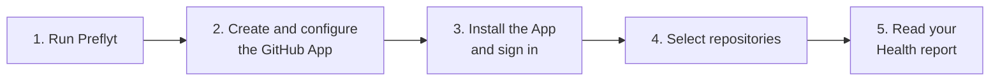

# Getting Started

This section takes you from installation to a first repository report. Selection automatically queues Health analysis. Built-in isolated scanners run automatically without additional repository approval, standards or a workflow. Unavailable scanners are reported as failures, never clean scans. Tests have not run. To reach a verified PR result, continue through policy and workflow setup below.

1. [Quick Start](quick-start.md): run a local instance and sign in as Super Admin.
2. [Connect GitHub](connect-github.md): create the GitHub App, save it in Preflyt and sign in with GitHub.
3. [Select repositories](select-repositories.md): choose what Preflyt may read.
4. [Your first report](first-assessment.md): follow the queued Health assessment, findings and limits.

:::info Who does what
- A **Super Admin** (the recovery account from your `.env`) configures the deployment: GitHub App credentials, sign-in and notifications.
- A **GitHub organization owner** signs in with GitHub and creates the workspace.
- Workspace **Owners and Admins** select repositories, adopt standards and create assessments.
- Other members work within their assigned roles and repository scopes.
:::

If you only want to evaluate Preflyt on one machine, follow the pages in order. For a real deployment, do the [Self-Hosting](../self-hosting/index.md) setup first.

## From your first report to a verified PR

1. Create or choose a [standard](../user-guide/standards.md), then create, approve and publish a [policy](../user-guide/policies.md) for the branch you target. Repository standards and branch policy versions are separate; saving one does not publish the other.
2. Have the deployment administrator enable event ingestion, PR check publication and automatic checks, and configure a public HTTPS API URL. Enable checks for your repository in **Settings → PR feedback**.
3. In **Policies → CI jobs**, copy the workflow snippet or review and create a setup PR. Merge the reviewed workflow change into the target branch through your normal GitHub process.
4. Open a same-repository, non-draft test PR. The workflow runs checks, submits reports and waits in its final gate. Confirm the current head commit has a published **Preflyt / Engineering Readiness** check and a matching assessment.
5. If wanted, add [AI reviews](../user-guide/ai-reviews.md), keeping your chosen provider and explicitly enabling code sharing. Test their publication on a PR.
6. Only after the verified PR path works, optionally activate [Merge Protection](../user-guide/merge-protection.md), or require the check yourself in GitHub.

The public [Preflyt Action](https://github.com/marketplace/actions/preflyt-policy-check) needs no Preflyt API key. One GitHub App is enough. An external report signer, a second governance App and [native execution](../user-guide/native-execution.md) are **not prerequisites** for this path. Private application images still require registry pull access; the public Action does not grant access to them.
