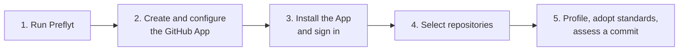

# Getting Started

This section takes you from nothing to a recorded assessment of one of your repositories.

| Step | Page | Time |
| --- | --- | --- |
| 1 | [Quick Start](quick-start.md): run a local instance and sign in as Super Admin | About 10 minutes, mostly image builds |
| 2 and 3 | [Connect GitHub](connect-github.md): create the GitHub App, save it in Preflyt and sign in with GitHub | About 15 minutes |
| 4 | [Select repositories](select-repositories.md): choose what Preflyt may read | 2 minutes |
| 5 | [Your first assessment](first-assessment.md) | 10 minutes |

:::info Who does what
- A **Super Admin** (the recovery account from your `.env`) configures the deployment: GitHub App credentials, sign-in and notifications.
- A **GitHub organization owner** signs in with GitHub and creates the workspace.
- Workspace **Owners and Admins** select repositories, adopt standards and create assessments.
- Other members can view results.
:::

If you only want to evaluate Preflyt on one machine, follow the pages in order. For a real deployment, do the [Self-Hosting](../self-hosting/index.md) setup first.
