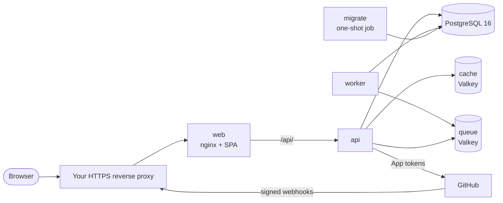

# Self-Hosting Introduction

Preflyt runs entirely as containers. The same application images run under **Docker Compose** or **Kubernetes**; only the manifests differ.

See [Community Edition](community-edition.md) for included scope, licensing and current public-release preparation status.

## Components

| Service | Purpose |
| --- | --- |
| `web` | nginx serving the web app. It forwards `/api/` to the API on the same origin. This is the only service that publishes a host port. |
| `api` | The application API: sign-in, repositories, standards, assessments, webhooks. |
| `worker` | Background processing: webhook events, CI evidence, reconciliation and notifications. |
| `migrate` | A one-shot job that applies database migrations before the API starts. |
| `health-engine` | A separate TLS-protected Docker-in-Docker engine for scanner containers; the only privileged service. |
| `health-init` | A one-shot job that prepares protected scanner volumes and client certificates. |
| `health-scanner` | Runs fixed static Health analyzers and returns signed results; no application credentials. |
| `db` | PostgreSQL 16. The source of truth for all Preflyt data. |
| `cache` | Valkey (Redis-compatible), 128 MB, evicting, no persistence. Metadata cache only. |
| `queue` | A separate Valkey with `noeviction` and AOF persistence for the job queue. |
| `otel-collector` | Optional OpenTelemetry collector, started with the `observability` profile. |

Only `web` is reachable from the host, and only on loopback (`127.0.0.1:8080` by default). The API, database, cache and queue have no host ports.

## Requirements

- Docker Engine or Docker Desktop with **Compose 2.23.1 or later**.
- A GitHub organization where you can create a [GitHub App](github-app.md). Preflyt connects to GitHub only through this App.
- For production: a host **HTTPS reverse proxy** and a public origin such as `https://preflyt.example.com`. See [Reverse proxy and TLS](reverse-proxy.md). Preflyt does not install certificates for you.
- Optionally, an OpenID Connect provider if you want [single sign-on](authentication.md).

Node.js, pnpm, PostgreSQL and Redis do **not** need to be installed on the host.

## Choose how to deploy

| Option | Use it for |
| --- | --- |
| [Docker Compose](docker-compose.md) | A single host. The recommended starting point for evaluation and small teams. |
| [Kubernetes](kubernetes.md) | A single-instance bundle for clusters. Ingress, TLS, storage backups and capacity are your responsibility. |

:::note Images
Preflyt runs from container images stored privately at `ghcr.io/lyrisoft`. You need an account with read access to those packages, and you sign in with `docker login ghcr.io`. You do not need the source code. Stable releases use `vX.Y.Z` image tags; development builds use `sha-` plus the 40-character commit ID. Choose an existing published tag.
:::

## What stays outside the containers

Preflyt does not provide your TLS certificate, DNS, off-host backups or monitoring backend. The default stack includes static Health analyzers. It does not execute repository tests or arbitrary commands: general native execution stays disabled until you deploy its separate, reviewed controller. See [Evidence and trust](../concepts/evidence-and-trust.md).
