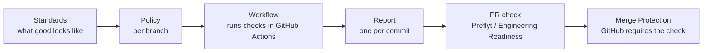

# User Guide

This guide covers everything you do in Preflyt after it is installed and connected to GitHub. If you have not done that yet, start with [Getting Started](../getting-started/index.md).

## How the pieces fit

1. A **standard** is a versioned set of checks, such as "tests pass" or "no secrets in the code".
2. A **policy** says which standards a branch must meet, for example `main`.
3. Your **GitHub Actions workflow** runs the checks. Preflyt gives you the YAML to add.
4. Each pull request produces a **report**: what passed, what failed and what has no result yet.
5. Preflyt publishes the result on the pull request as a **check**.
6. **Merge Protection** makes GitHub require that check before a merge.

You can stop at any step. Reports and checks are useful on their own, and nothing blocks a merge until you require the check in GitHub.

## Who does what

| Role | What they typically do |
| --- | --- |
| **Super Admin** | Configures the deployment: GitHub App, sign-in, email, feature switches. |
| **Owner and Admin** | Select repositories, create standards, assign them to teams, manage access. |
| **Policy Manager** | Creates, reviews and publishes policies. |
| **Engineering Lead and Developer** | Create reports and read results for their repositories. |
| **Auditor and Viewer** | Read results. They cannot change anything. |

See [Access Control](access-control.md) for the full list.

## Pages in this guide

| I want to… | Page |
| --- | --- |
| Create or choose what my code must meet | [Standards](standards.md) |
| Decide which standards apply to a branch | [Policies](policies.md) |
| Get checks running on every pull request | [Pull request checks](pull-request-checks.md) |
| Make GitHub block a failing pull request | [Merge Protection](merge-protection.md) |
| See issues across my repositories | [Findings](findings.md) |
| Apply standards to a group of repositories | [Teams](teams.md) |
| Invite people and set what they can do | [Access Control](access-control.md) |
| Get AI review comments on pull requests | [AI reviews](ai-reviews.md) |
| Understand optional Preflyt-hosted checks | [Native execution](native-execution.md) |
| Review workspace audit history | [Audit log](audit-log.md) |
| Get alerts about results | [Notifications](notifications.md) |
| See who works on what | [Contributors](contributors.md) |
