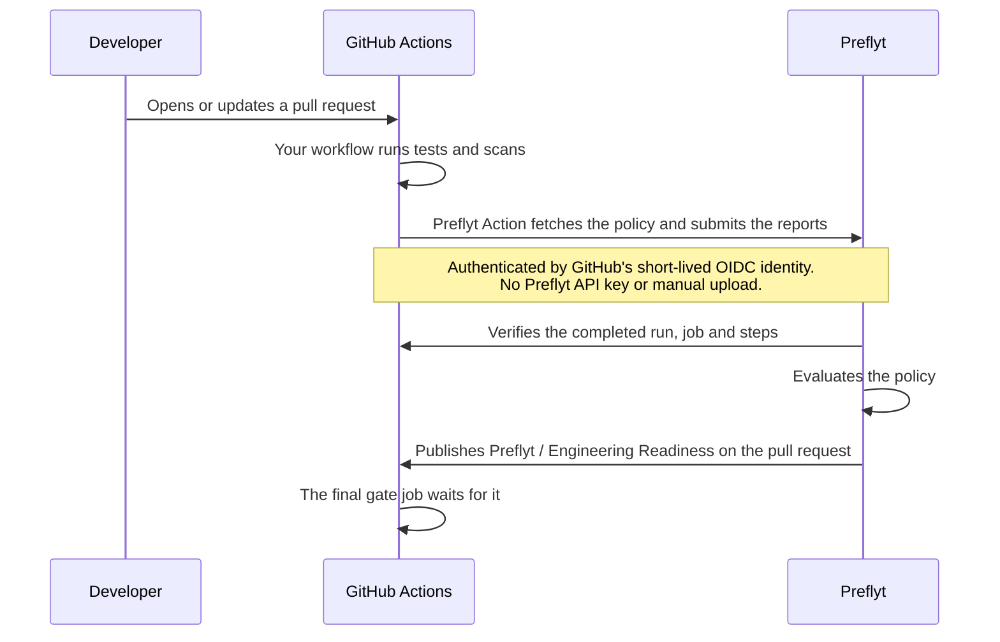

# Pull request checks

Preflyt can check every pull request against your published [policy](policies.md) and show the result on the pull request as a GitHub check named **Preflyt / Engineering Readiness**.

Your own GitHub Actions workflow runs the tests and scanners. Preflyt then verifies that the run really happened and evaluates the result.

## How it works



A result only counts when Preflyt verifies the actual report-producing jobs for the current run attempt and PR head commit. The final gate runs in the same workflow after those jobs finish; Preflyt does not wait for that gate to finish before evaluating its predecessors. An uploaded report or a success label on its own can never produce a pass.

## Review saved check results

Open **Repositories → your repository → Checks** to see the latest saved assessment for the selected standards and revision. The cards show passed checks, failed checks and checks with missing or unverified evidence. The results table explains each check and links to its saved evidence.

The **assessed commit** identifies the revision those results apply to. It can differ from the inspected commit in the repository profile. A successful GitHub job alone does not establish a passing Preflyt check; the saved server evaluation verifies the required evidence. When no assessment exists or verification fails, result counts remain unavailable.

Assessment activity appears above the results and counts saved evaluations, including repeated evaluations of the same commit. Configuration setup and check sources are under **Standards**. GitHub's current merge permission remains separate from these historical saved results.

## Before you start

Check each of these. Several need a deployment administrator.

| # | What | Where |
| --- | --- | --- |
| 1 | The GitHub App has **Checks: Read and write**, **Actions: Read-only** and **Pull requests: Read** (write for comments). | [GitHub App](../self-hosting/github-app.md) |
| 2 | The repository is [selected](../getting-started/select-repositories.md). | Repositories |
| 3 | **Public Preflyt API URL** is set to a public HTTPS address that GitHub can reach, not `localhost`. With Preflyt's bundled web proxy, include `/api`, for example `https://preflyt.example.com/api`. | **Settings → Configuration → GitHub** (Super Admin) |
| 4 | **Publish PR checks** and **Automatic PR checks** are on. | **Settings → Configuration → Governance** (Super Admin) |
| 5 | A [policy is published](policies.md) for the branch pull requests target. | **Policies** |
| 6 | PR checks are on for the repository. | **Settings → PR feedback** |

For item 6, open **Settings → PR feedback**, choose the repository and select **Enable checks**. **Enable checks for all** turns them on for every connected repository.

The **Public Preflyt API URL** applies without a restart. If it is empty, the snippet shows `<PUBLIC_PREFLYT_API_URL>` and a note tells you to ask a deployment administrator to set it.

## Install the policy runner once

1. Open **Policies** and choose the **CI jobs** tab.
2. Choose the repository and the branch policy. Under **Policy workflow snippet**, select **Copy snippet**. You can also use **View YAML** on any standard in **Standards**.
3. Paste it into your pull request workflow, for example `.github/workflows/ci.yml`. Keep your own dependency installation steps **before** the Preflyt step.
4. Commit it to a branch and open a pull request.

The generated standalone snippet has two jobs. When integrating with an existing workflow, keep its check jobs and add one terminal gate:

- **`preflyt_checks`** runs your checks and submits the results using the Preflyt Action.
- **`preflyt_gate`** (named **Preflyt final gate**) waits for Preflyt's verified result and fails if the policy fails or is incomplete. It depends on every other job in that PR workflow. Do not add a separate `workflow_run` publication-gate workflow. Documentation and post-merge deployment workflows can remain separate.

The snippet contains your API URL and an immutable Preflyt Action pin. It contains no check list or report mapping. The Action fetches the published target-branch policy at the beginning of each run. Adding a check or changing a standard takes effect after you publish a new policy revision; the workflow stays the same.

```yaml
# Shape of the generated snippet. Copy the real one from Preflyt.
jobs:
  preflyt_checks:
    runs-on: ubuntu-latest
    permissions:
      contents: read
      id-token: write          # lets the Action prove its identity to Preflyt
    steps:
      - uses: actions/checkout@...
        with:
          ref: ${{ github.event.pull_request.head.sha }}
          persist-credentials: false
      # Your dependency installation steps go here.
      - name: Preflyt policy
        if: ${{ always() && github.event_name == 'pull_request' }}
        uses: lyrisoft/preflyt-action@<pinned commit>
        with:
          api-url: https://preflyt.example.com/api
  preflyt_gate:
    name: Preflyt final gate
    needs: [preflyt_checks]
    # ...
```

### What the built-in checks run

The built-in security recipes automatically pull pinned scanner images: **Semgrep** for static application security, **Gitleaks** for secrets, and **Trivy** for dependency, container and infrastructure scans. Docker must be available on the Linux runner. Source is mounted read-only, scans receive no GitHub/OIDC credentials or Docker socket, and raw scanner logs are suppressed. Set `CONTAINER_IMAGE` in the job when selecting container image scanning.

Build, type checking, tests and lint reuse the project tools installed in the job. Keep your dependency installation before Preflyt. Configure a **Workflow command** and **Result file** in [Standards](standards.md) for a project-specific or custom control. Commands belong to the approved policy revision; editing an unpublished standard does not change an active policy. A required check without a runnable command, tool or real report stays **Incomplete**.

An Action submission can include up to **10 reports**. Custom commands must produce real results for the selected check; missing or unrelated reports cannot satisfy it.

### Let Preflyt open the pull request for you

Instead of pasting, open the **CI jobs** tab and use the **GitHub workflow** panel:

1. Choose the workflow to change with **Choose workflow**.
2. Use **Edit YAML**, choose the job and select **Install policy runner**. **Rewrite with AI** can help preserve existing jobs. Review the proposal before using it.
3. Choose **Create setup PR**.

Preflyt opens a pull request that adds the workflow. It never edits your default branch directly, and the App needs **Contents**, **Workflows** and **Pull requests** write permission for this. **Download files** is a fallback if you would rather commit it yourself.

## What you see on a pull request

| Where | What |
| --- | --- |
| **Checks tab** | **Preflyt / Engineering Readiness**: passed, failed or incomplete. |
| **Checks tab** | **Preflyt final gate**: the job in your workflow that fails when the result is failed or incomplete. |
| **Checks tab** | **Preflyt / AI Review**, if [AI reviews](ai-reviews.md) are on. It is always advisory. |
| **Pull request comment** | An optional policy summary, if you turn it on in **Settings → PR feedback**. |
| **Preflyt** | A report under **Assessments**, and a row in **Merge Protection → PR checks**. |

After the first verified run, Preflyt connects the workflow automatically and shows **Workflow connected. Completed runs appear in Assessments.** Under **Recent policy runs** you can open each report.

### Optional pull request feedback

In **Settings → PR feedback**:

- **Post a policy summary comment on the PR** adds one comment per pull request.
- **Review changed code with AI and comment on PRs** turns on AI review. It needs [AI set up](ai-reviews.md).

Comments and AI suggestions are feedback. Findings never override the deterministic check result. When automatic AI feedback is enabled, the final gate waits for its publication; a provider or publication failure can fail the workflow even though the AI findings themselves are advisory. Inline feedback is limited to five actionable issues and deduplicated across commits; the PR summary is kept short.

## Branch policies and deployment

Policies select requirements for the **PR target branch**. They do not rewrite your workflow triggers or job conditions. To run different checks for `development` and `main`, publish a policy for each, then update the workflow with branch conditions and real reports that satisfy each policy. Re-run a PR to each target to verify the routing.

PR validation does not inherently require Docker images. Type checks, lint, compilation, tests and scanners can run on the runner. Docker Compose integration tests do need images or prebuilt images, so schedule them explicitly where needed. Building and publishing deployment images belongs in a separate post-merge `push` workflow when that matches your release process. Preflyt does not deploy your application or publish its images for you.

## Make it required

A check on a pull request does not block anything by itself. To make GitHub require it, see [Merge Protection](merge-protection.md).

## Limits

- Pull requests from the **same repository** only. Fork pull requests and merge queues are not supported.
- **Draft** pull requests are not checked.
- The runner must be Linux with **Python 3 and Git**. GitHub's `ubuntu-latest` has both.
- The Action must run in a job with `contents: read` and `id-token: write`.

## If something does not appear

| Symptom | Check |
| --- | --- |
| The snippet shows `<PUBLIC_PREFLYT_API_URL>` | A deployment administrator has not set **Public Preflyt API URL**. |
| The Action fails to reach Preflyt | The API URL must be public HTTPS. GitHub's runners cannot reach `localhost`, a private network or a self-signed certificate. |
| **No workflows found** | Commit the snippet to a workflow file in the repository first. |
| No **Preflyt / Engineering Readiness** check | PR checks are off for the repository, **Publish PR checks** is off, no policy is published for the target branch, or the App lacks **Checks: write**. |
| The gate job times out | Preflyt did not verify the run in time. Open the report and the [webhook deliveries](../self-hosting/troubleshooting.md#github). |
