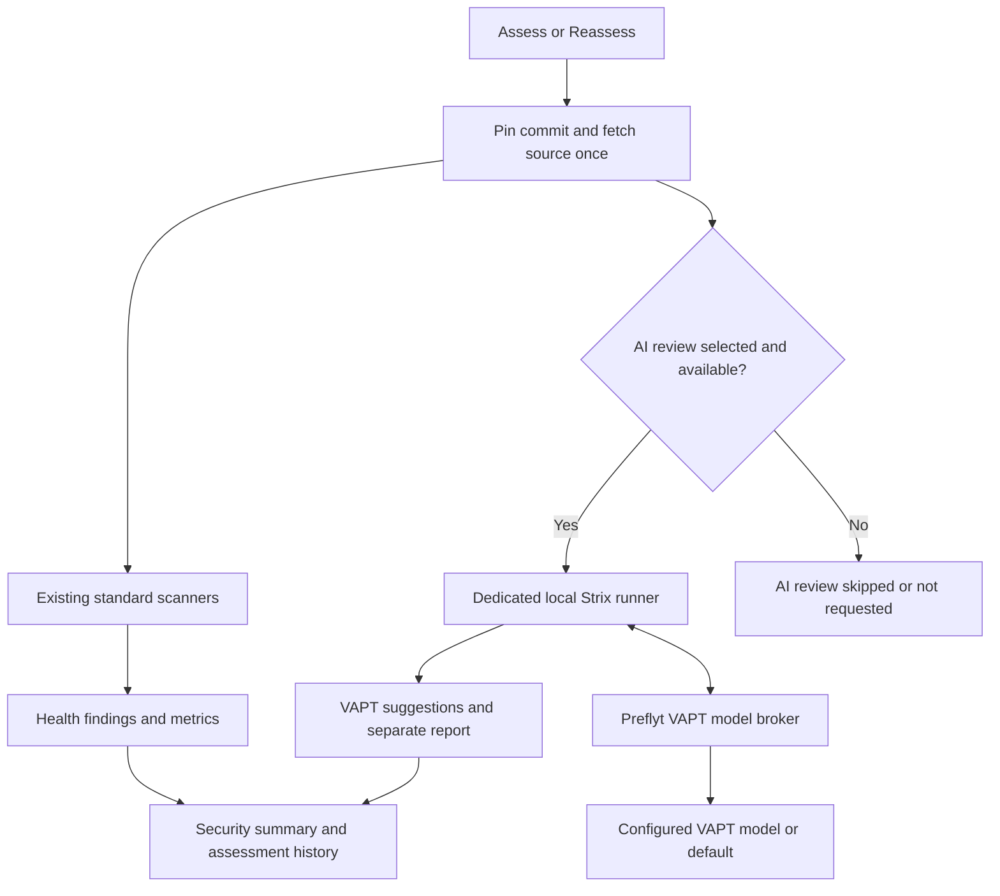

> Product terminology: this source-only capability is labeled **AI security review** in the interface. Existing `vapt` routes, workload keys and saved configuration remain compatible. Historical qualification notes below retain their original names. Live API/website penetration testing is a separate, unimplemented capability.

# Local Strix scanner in Repo Health

Status: beta source-only review, with local development and optional production Compose packaging. See [production setup](strix-production-compose.md). No CI integration, PR comments, merge checks or
remote writes are enabled by this feature. Strix source is pinned to
`a0f8ea2cd379c4bf56e665d3db2ba8a4f7c0683c` (package version 1.7.0).

## Assessment flow



## What runs

Repository Health uses one **Assess repository / Reassess** action with an
optional **Include AI security review** selection, remembered per repository.
It creates a standard assessment and a linked advisory AI review at the same pinned
commit, using the existing Health queue, permissions and history. If no enabled,
tested AI model route is connected, source sharing is disabled, permission is
missing or the scanner is unavailable, the AI review is recorded as **Skipped**
and standard checks continue. Automatic branch assessments remain standard-only.
The default Health result and portfolio summary continue to use the static scan;
a Strix review is shown separately in the same Health view and Security workflow.

The dedicated local controller invokes the real open-source Strix engine in
headless, full-repository, standard mode. Its source is uploaded into an ephemeral
sandbox. The original checkout is not mounted or modified. A fixed review profile
covers authentication, authorization, payment logic, webhooks, idempotency and
concurrency. It is advisory analysis, not guaranteed complete payment auditing.

The controller requests inference through a job-scoped Preflyt broker. The broker
uses the enabled **Security testing (VAPT)** AI route (or its existing Default fallback), requires
source sharing and a tested provider, and rechecks access/configuration on each
request. Provider keys remain in the API. OpenAI-compatible, Anthropic and Gemini
routes are supported by forwarding each provider's native tool-calling protocol;
provider-specific live acceptance is still required. No new model key is entered
in the runner. Fallback inference is not automatically replayed after a paid scan
has started.

## Local setup

### Per-model token usage

In **AI Intelligence → Models**, select a connected model name to open its usage
details. `GET /ai/configuration/providers/:id/usage` requires `ai.usage.read` and
scopes both totals and history to the current organization and readable
repositories. It supports 7, 30 or 90 days and 10, 25, 50 or 100 grouped activity
rows per page. Totals cover the whole selected period, independently of pagination.

`AiModelUsage` records one inference attempt with a pinned connection ID, model
name and provider revision, source job, workload, timestamps and nullable
provider-reported token counts. VAPT, advisory AI reviews, finding guidance and
workflow generation/rewrite are instrumented. Metadata connection tests and
pre-inference allowance refusals are excluded. Failed validation retains any
reported usage; transport failures without usage remain unknown. No prompts,
responses, provider keys or endpoint URLs are stored in these usage records.

Older VAPT allowance counters remain estimates and are shown separately, without
being added to provider-reported totals. If a connection has since changed model
revision, an unrecorded historical model name stays unknown. Usage tracking does
not reconstruct provider billing history or estimate prices.

Provider usage normalization follows the documented fields: [DeepSeek input and
cache counts](https://api-docs.deepseek.com/api/create-chat-completion/), and
[Anthropic total input including cache reads and writes](https://platform.claude.com/docs/en/build-with-claude/prompt-caching#tracking-cache-performance).

### VAPT scan limits

Organization administrators configure cumulative allowances under **AI Intelligence
→ VAPT limits**: input tokens (default 4,000,000; range 100,000–100,000,000),
output tokens (default 131,072; range 8,192–2,000,000), and model requests (default
80; range 1–1,000). Saving requires `ai.routing.manage`, uses revision checks and
records `ai.vapt-limits.saved` in the audit log. Defaults apply until explicitly
saved. The API exposes these settings through `GET /ai/configuration` and
`POST /ai/configuration/vapt-limits`.

Each new queued scan snapshots these allowances in its Strix run. Editing settings
does not change active scans or model routing/source consent. The broker reserves
estimated input and up to 8,192 output tokens before a request; repeated context
counts again, so the input allowance is conservative. A request must fit the
remaining allowance. Actual output usage releases unused output reservation.
Exhaustion blocks further inference with a non-retryable response and an explicit
input, output or model-request failure code. The worker cancels the owned runner,
waits for confirmed cleanup and saves the failed assessment. Concurrency-only
refusals remain temporary. Standard scanning continues independently.

These settings do not increase a provider's per-request context window. Runner
safety limits still apply: 30 minutes, 40 turns per agent and the engine's nominal
5-dollar estimated cost ceiling. That estimate is not a billing receipt.

### Start the local runner

1. Apply migrations and regenerate the client:

   ```sh
   pnpm --filter @preflyt/api prisma:migrate
   pnpm --filter @preflyt/api prisma:generate
   ```

2. Keep the local API and worker running with the same database and configuration.
   Enable and test a model connection in AI Intelligence, enable Security testing (VAPT) or
   Default routing and allow source sharing. Existing repository `execution.run`
   and `ai.review.run` permissions are both required.

3. Start Docker and Python 3.12 or newer, then run from the project root:

   ```sh
   ./scripts/strix-local.sh
   ```

   The API authorizes each connected repository before admission. The script creates an isolated
   Python environment, installs pinned Strix source and dependency constraints if
   needed, fetches the tested sandbox by immutable digest and builds the restricted
   local sandbox. First setup
   downloads a substantial toolkit image and Python dependencies.

   The controller binds only to `https://127.0.0.1:3012`. Its protected connection
   file is `apps/api/.preflyt/strix/connection.json`. API/worker development processes
   started from `apps/api` find it automatically; otherwise set `STRIX_CONNECTION_FILE`
   to that absolute path. `STRIX_CALLBACK_ORIGIN` in API/worker and `PREFLYT_API_ORIGIN`
   in the runner default to `http://127.0.0.1:3000` and must agree.

4. Refresh Repo Health. Select the test branch, open the arrow beside **Assess repository/Reassess**, select **Include AI security review**
   and choose **Assess repository / Reassess**. The status section polls automatically.
   **View AI security report** opens the saved
   report and its source-linked suggestions. Scanner counts and Strix suggestions
   remain distinct. Cancellation is available while a review is queued/running.

### Local Docker Desktop application stack

The optional `compose.strix-local.yaml` overlay connects the containerized API and
worker to the same authorized host controller. It is a development bridge, not
production Strix packaging. Stop any host application worker using the same database
before starting Compose. Keep the controller running in a separate terminal:

```sh
PREFLYT_API_ORIGIN=http://127.0.0.1:3001 ./scripts/strix-local.sh
```

The controller supports all connected repositories that the requesting user may
review. Start the local application with the overlay (and the external database
overlay when reusing the existing local Preflyt database):

```sh
docker compose -f docker-compose.yaml -f compose.local.yaml -f compose.external-db.yaml -f compose.strix-local.yaml up -d --build --wait --wait-timeout 1800
```

The UI remains at `http://localhost:8080`. The controller's model callback uses the
API's additional loopback-only port `3001`. Two credential-free TCP sidecars relay
the API/worker loopback connections to the host controller without terminating TLS;
certificate validation and runner authentication remain end to end. An isolated
initialization container copies only the protected controller connection file into
a volume readable by the API and worker. No Docker socket or provider key is given
to a bridge. The host controller remains required.
Restart it after a host reboot; if its connection identity changes, recreate the
connection initialization job and API/worker bridges before using AI review.

## Shared source preparation

The repository page retains an unsent AI selection across Health panel remounts,
including background profile refreshes and branch changes. The main action checks
that an AI-selected response confirms both the request flag and a linked AI review;
otherwise it displays an explicit error without automatically repeating the request.
The request audit now records `includeAiSecurity`, `aiReviewId` and `aiReviewState`.
Earlier audit records did not retain these fields and cannot establish the user's
checkbox state. VAPT finding rows are labeled **AI security review (VAPT)** while
preserving their advisory evidence and existing Health report links.

Each combined assessment resolves the branch once and exports one verified
source bundle. Both scanner jobs use that exact source SHA, content hash and
export policy, with independent disposable copies. An AI job cannot take a worker
slot before source preparation. Standard and AI jobs may then progress separately;
an AI failure never changes the standard report or merge evaluation.

The trusted worker retains AES-256-GCM encrypted source in `HEALTH_SOURCE_DIRECTORY`
(local default: the protected `preflyt-health-sources` folder under the OS temporary
directory). Its key is derived from `CONFIGURATION_ENCRYPTION_KEY`; access is bound
to organization, repository, assessment owner, commit, content hash, export version
and expiry. Source is not placed in PostgreSQL records or queue payloads. Metadata
and the parent/child assessment relationship are stored in PostgreSQL.

Compose mounts a worker-only `health_sources` volume at `/var/lib/preflyt-health-sources`.
The API and scanners do not mount this scratch volume. Multiple worker instances
must share this directory and encryption configuration if jobs can move between them.
Retrieving source still requires current repository/AI permissions and source consent.
The worker removes scratch after both jobs are terminal, and prunes leftovers after
four hours. Source is bounded by the existing export limits; scratch admission also
checks retained disk usage. Missing, expired, modified or inaccessible cached source
never triggers a fetch of a newer branch head; the affected job stops with an explicit
source-unavailable result. If scratch cannot be prepared initially, AI is skipped
and standard checks use the already fetched bundle.

## Deliberate local boundary

On 2026-10-18, the owner authorized this local source-only runner for all connected
repositories. The former test-repository allowlist has been removed. The API still
requires an active repository connection, organization-scoped execution and AI
review permissions, a tested model route and source-sharing consent before it can
admit a source snapshot. The controller remains authenticated and loopback-only;
this development authorization does not qualify the runtime for hosted customer execution. The upstream
Docker backend is replaced: no passwordless sudo, added capabilities, host gateway,
host mounts, unrestricted networking or provider keys in the sandbox. The source
copy, scratch memory, CPU, process count, output and deadline are bounded.
A loopback-only Docker-exec tunnel lets the trusted controller reach the sandbox
proxy without adding an outbound route or mounting a socket into the job. The
network is an internal Docker network; external targets and dependency downloads
are unavailable. Existing external services may therefore leave a review incomplete.

Strong real-repository runtime qualification under ADR-0002, supported production
Compose packaging and additional provider/runtime acceptance remain release gates.
Further real-repository tests require explicit owner authorization; broader use
still requires the ADR runtime qualification. No live application target is admitted.
The API and ordinary worker never run the Strix subprocess or receive Docker access.

## Results and failure behavior

- Exit 2 with a completed Strix run means findings were reported, not scanner failure.
- Missing reports, unsuccessful engine status, source mismatch, unsafe coordinates,
  interruption and lost runner state do not become successful clean scans.
- All Strix results are `AI_REPORTED` / **Suggestions only**. The agent's confidence,
  PoC text and completion claims are not independent proof of an exploit.
- The adapter reads JSON findings, not synthetic SARIF `SECURITY.md` anchors or
  non-failing coverage rows. Source locations are checked against the original
  verified snapshot; locationless findings remain locationless.
- Raw traces, PoCs, generated patches and source snippets are not imported into
  Health. The local controller deletes scratch after collecting bounded fields;
  receipts retain only adapter fields. Stop the runner and remove its protected
  state directory to remove local receipt data. Receipts older than seven days
  are pruned on startup.
- Each scan has a 30-minute deadline and Strix's estimated $5 budget, plus 40 turns
  per agent. Preflyt enforces a separate ceiling of 80 model requests, two concurrent
  requests, at most 900 KB of JSON per model request, four million cumulative
  input tokens, 131,072 output tokens and a 90-second model-request deadline.
  Token estimates and Strix's dollar calculation are not provider invoice guarantees.
- Access revocation, source-consent withdrawal, route/provider changes and
  cancellation block new model calls and request sandbox cleanup. Runner restart
  does not replay paid scans. Start a new review after inspecting an interrupted run.
- An explicit `RUNNER_BUSY` refusal returns the assessment to the queue with a
  15-second retry delay and releases its worker slot. Only this pre-admission
  refusal permits another admission; uncertain transport failures never replay
  a potentially paid scan.
- Report storage, the terminal Strix marker, source-excerpt queue, audit event
  and notification commit together. A failed transaction can retry collection
  from the runner receipt. Completed receipts from older partially finalized
  runs can also be recovered after current authorization and configuration checks.
- Saved VAPT reports include bounded, redacted **Source review coverage**: up to
  100 AI-reported areas, 50 unresolved gaps and 10 caveats. Missing, invalid or
  truncated ledgers remain explicitly unknown/incomplete. Raw execution evidence,
  commands and PoCs are not retained, and coverage entries never establish a
  verified test or a secure area. Historical reports without a ledger remain readable.

## Opt-in source-fixture acceptance

From `apps/api`, after local setup:

```sh
PREFLYT_STRIX_ACCEPTANCE=1 node --env-file=.env --import tsx test/strix-live.acceptance.ts
```

This runs the real standard Health scanner and Strix engine, using the existing enabled, tested VAPT/default
model route against a generated, one-file Python fixture with a known tenant
authorization defect. Both scanner services must be ready and source sharing must already be enabled. Set `HEALTH_SCANNER_CONNECTION_FILE` if the standard scanner uses a non-default local connection file. Normal provider
charges apply under the ordinary scan limits; the harness also cancels after
ten minutes. It reads routing configuration without updating it, uses a random
disposable local database and separate loopback broker/controller ports, and
never sends a connected repository's source. It requires both assessments to complete with one source fetch and matching commit/source hashes,
a source-linked AI suggestion, imported coverage, a committed terminal marker
and no CI/merge assessment records. Its runner and database are removed afterward.

One successful fixture is integration evidence for that provider/image combination,
not a detection-accuracy benchmark or runtime qualification for customer source.
Other provider families and vulnerable/fixed fixture evaluation remain separate.

## Evaluation against the supplied payment rubric

| Sample domain | Source-supported Strix fit | Additional work / limits |
| --- | --- | --- |
| Discovery | Source-aware mapping, framework guidance, AST/static triage and coverage ledger | Mapping is agent-directed, not a guaranteed complete deterministic endpoint inventory. |
| Application security | Auth/JWT, IDOR, function-level access, injection and related knowledge packs | Detection precision/recall need held-out vulnerable and fixed fixtures. |
| Payment security | Business-logic and race-condition packs cover refunds, state transitions, idempotency, retries and webhook paths | Supply the payment invariants and stub providers; source-only concern is not reproduced money movement. |
| Financial integrity | Conservation-of-value and concurrent balance guidance exists | Full ledger accounting, settlement, reconciliation and FX control coverage are not established. |
| Infrastructure | Source/tooling and cloud/Kubernetes guidance exists | Retain Trivy/Gitleaks/Semgrep. No deployed cloud configuration or infrastructure penetration testing is implied. |
| Sensitive data / compliance | Information-disclosure and source-flow investigation | No PCI/AML/KYC certification, comprehensive PII discovery, log-store access or complete Git-history analysis is provided by the exported source snapshot. |
| Fraud / abuse | Business-logic, quota/limit, workflow and account-risk guidance | Needs explicit business rules, test identities, event timing and external risk-system context. |
| Risk / reporting | Structured findings, source locations, impact, confidence, counterevidence, CVSS and executive report | The sample's seven views, 5×5 risk matrix, validation taxonomy and QA test register need additional normalized product contracts. |

Conclusion: suitable for an optional agentic scanner alongside existing scanners,
not a drop-in implementation of the whole sample. The local prototype deliberately
imports suggestions without granting them deterministic policy authority. No
accuracy percentage or independently confirmed vulnerability claim is warranted
until live, independently reviewed fixture evaluation is complete.

## Source and license evidence

The Strix application source uses Apache-2.0. Its sandbox bundles third-party tools
with separate licenses; inventory and redistribution review are required before
publishing a packaged runner image. This local prototype does not publish one.

Primary references at the pinned source revision:

- [CLI arguments](https://github.com/usestrix/strix/blob/a0f8ea2cd379c4bf56e665d3db2ba8a4f7c0683c/strix/interface/cli_args.py)
- [Default Docker backend](https://github.com/usestrix/strix/blob/a0f8ea2cd379c4bf56e665d3db2ba8a4f7c0683c/strix/runtime/docker_client.py)
- [Business-logic guidance](https://github.com/usestrix/strix/blob/a0f8ea2cd379c4bf56e665d3db2ba8a4f7c0683c/strix/skills/vulnerabilities/business_logic.md)
- [Reporting contract](https://github.com/usestrix/strix/blob/a0f8ea2cd379c4bf56e665d3db2ba8a4f7c0683c/strix/tools/reporting/tool.py)
- [Coverage evidence distinction](https://github.com/usestrix/strix/blob/a0f8ea2cd379c4bf56e665d3db2ba8a4f7c0683c/strix/report/coverage.py)

## Local verification on 2026-10-18

- Prisma migration applied to the local development database; client regenerated.
- API and web type checks passed. Report and broker tests cover invalid tokens,
  route/source-consent checks, native provider payloads, limits and unsafe locations.
- Health lifecycle tests cover pinned source, separate static results, cancellation,
  revocation and lost runner state. Model configuration tests include VAPT routing.
- Browser tests cover Health controls, advisory finding labels and VAPT model routing.
- The real Strix SDK uploaded and read a harmless fixture; proxy startup and cleanup
  passed. Effective non-root, seccomp, no capabilities, no privilege escalation,
  read-only root, no host mounts, quotas and internal networking were checked.
- This machine used its existing cached upstream sandbox digest
  `sha256:478e0b37ec83b2ba8c6e159593cb46d5dc9b624a45d6a9bb606851b83058d284`
  (image tag 1.0.0) for this local test. Changing to a different upstream image, including 1.3.0,
  still requires its own compatibility run. These checks do not qualify a general
  adversarial/customer-code executor under ADR-0002.
- Source-only hardening acceptance: the real Strix 1.7.0 engine completed the
  generated one-file tenant-authorization fixture through the configured
  DeepSeek `deepseek-v4-pro` route in 188 seconds with 18 brokered model calls.
  One source-linked AI suggestion and an available coverage ledger were imported;
  the report remained partial/advisory, runner cleanup was confirmed, and no
  CI/merge assessment was created. The disposable database and isolated runner
  were removed. This qualifies that local integration path only.
- Hardening regressions passed: 97 API tests across Health, Findings and Strix;
  107 browser tests across Health, VAPT coverage/controls, finding details and
  model routing; eight Python runner/source-archive tests; API and web type checks
  and scoped web lint. Coverage-panel checks include pagination and 320px light/dark layouts.
- Unified assessment regressions passed: 122 API tests and 139 browser tests,
  API/web type checks, scoped web lint and Compose configuration validation.
  Coverage includes one-fetch revision binding, recovery, skipped AI with an
  unavailable model, independent scanner failure, cancellation, encrypted source
  retention, and the split assessment button's keyboard and 320px light/dark behavior.
- Live combined-fixture acceptance remains incomplete. One attempt completed the
  AI review with one source fetch but found the local standard scanner stopped;
  a retry with that service restored hit the ten-minute fixture deadline. Neither
  attempt establishes successful combined live acceptance. The disposable runner,
  database and relay were removed, and temporarily started scanner services were
  returned to their original stopped state. Those attempts used generated fixtures.
- On 18 October 2026, an explicitly authorized source-only run of
  `lyrisoft/maiguard-api` was started through the split-button UI with AI selected.
  The request audit retained the choice and linked AI job. Both jobs used commit
  `663420bb1162e8418bd61f6c171df85e2a6f3ba1` and source hash
  `d715478420da7a8591db2dd6c4062c459b254637f501f6848d21cd651a0a7ba5`.
  Standard scanning completed with a partial report and 4,712 retained analyzer
  findings. The configured DeepSeek `deepseek-v4-pro` engine stopped during model
  warm-up after three broker requests, with no AI findings or coverage ledger.
  A minimal diagnostic inference request confirmed HTTP 402, Insufficient Balance.
  AI workspace/sandbox cleanup and deletion of shared scratch after both jobs
  finished were verified. Launch, revision binding and failure handling passed;
  successful connected-repository AI review remains unverified until a funded model
  can complete inference. No further AI run was automatically started.
- A funded retry on 18 October 2026 used the connected DeepSeek `deepseek-flash`
  model (provider revision 8), with standard assessment
  `03081a74-3a97-4112-af86-e607452a5927` and AI assessment
  `c7d9c20b-e5ee-424b-bb3b-89636b9fce55`. Both retained the same commit and
  source hash above. The model returned responses, but the AI run failed after
  35 broker requests: its reserved input-token counter reached 3,969,342 of the
  4,000,000 allowance, leaving too little for the next request. Runner diagnostics
  confirmed repeated `Strix model request limit reached` errors and no provider
  request failures. Budget exhaustion currently returns a retryable error; the
  runner retried until it failed at 18:51:33 UTC. No AI findings or coverage ledger
  were imported. The standard report retained 4,712 findings with partial coverage.
  Sandbox, workspace and shared-source cleanup passed. This confirms funded model
  connectivity, not successful end-to-end repository review. Bounded review scope,
  finalization within the request allowance, and explicit non-retryable budget
  failure handling remain acceptance gaps. No allowance was increased or second
  paid retry started.
- Configurable VAPT allowances and explicit budget-failure cleanup were subsequently
  verified with 102 focused API tests and 31 browser tests, including administrator
  permissions, organization isolation, validation, stale revisions, limits fixed
  on queued scans, permanent versus concurrency-only refusals, cleanup before
  terminal failure, and 320px layouts in both themes. API/web type checks, lint and
  the complete local Compose rebuild passed. The additive migration was applied
  after a protected local database backup. The signed-in settings page saved and
  reloaded the existing default values; all nine long-running Compose services
  were healthy and the VAPT controller was reachable. No additional model scan
  was started for settings acceptance; successful connected-repository review
  remains unverified.

- An explicitly authorized standalone retry on 18 October 2026 used assessment
  `43016dd3-23cd-4636-80ca-819f93a9e1d4`, `scanner: strix`, no parent/child pair,
  and no standard assessment. The input allowance was raised through the signed-in
  settings page to 12,000,000; output and request allowances remained 131,072 and
  80. The existing service admission path checked repository permissions and
  runner readiness. DeepSeek `deepseek-flash` reviewed the same commit and source
  hash above. The scan crossed the former input allowance, then failed at the
  unchanged 80-request ceiling at 19:23:33 UTC, recording
  `STRIX_REQUEST_LIMIT_REACHED`, 9,215,802 reserved input tokens and 32,550 output
  tokens. No AI findings or usable coverage ledger were saved. Terminal status,
  sandbox removal and workspace cleanup were verified. This establishes
  standalone admission and bounded failure handling; successful end-to-end
  connected-repository review is still unverified. No further retry was started.

- Per-model usage tracking was deployed locally on 18 October 2026 after a protected
  database backup and the additive `20261018210000_ai_model_usage` migration.
  Focused API and browser checks covered recorded usage, missing token counts,
  historical model names, pagination, organization/repository permissions and
  responsive layouts. The signed-in model details page loaded real historical
  VAPT allowances separately from new provider-reported usage. All nine Compose
  services were healthy and deployment smoke checks passed. No additional paid
  inference or repository scan was started for this verification.

The pinned local engine now plans bounded agent work from the snapshotted request
allowance, caps direct specialists at two, rejects nested delegation, omits copied
parent histories and caps tool output. At 80 requests, root and specialists each
receive 16 turns, leaving room for model preflight, deduplication and finalization.
Coverage gaps must remain explicit; the adapter never fabricates completion after
an engine failure. Eleven runner checks and 40 focused API checks passed.

Retry `06fa6ef7-7f9a-4869-b1aa-db672425a949` picked up the currently configured
Ollama `llama3.2:3b` route, rather than the earlier DeepSeek route. Its three model
attempts failed before inference: `localhost:11434` is unreachable inside the API
container, while the host Ollama metadata endpoint is reachable through
`host.docker.internal:11434`. No normal assessment ran alongside it. Successful
connected-repository AI review remains unverified.

For local troubleshooting only, `PREFLYT_STRIX_DEBUG=1` retains the last 64 KiB of
failed engine output in the protected `debug/` state folder. The scoped model token
is redacted, but repository context can remain. This is off by default, never
imported into Health, and should be removed after troubleshooting.

### Connected-repository local runner and Ollama compatibility

The owner's 18 October 2026 request removes the local test-repository allowlist.
`PREFLYT_STRIX_TEST_REPOSITORIES` is no longer required or consulted. Authenticated
capabilities accept valid numeric GitHub repository IDs; actual admission still
passes through Preflyt's connection, organization, repository permission, tested
model and source-sharing checks. Controller TLS authentication, fixed callback
origin, matching source repository/hash and sandbox isolation are retained.

The API gives local inference up to ten minutes per request (hosted requests retain
90 seconds). Local Gemma4 uses Ollama's supported `reasoning_effort: none` direct
generation mode to avoid consuming the bounded response on thinking before a tool
call. Hosted inference settings are unchanged. Neither change raises cumulative
scan limits. The source-only coordinator is instructed to use the supplied review
scope instead of inventing skill identifiers.

Verification: 37 focused broker/health API checks and 13 runner checks passed;
three sandbox smoke checks were skipped by the unit-test command. API typechecking
and Compose image builds passed. Authenticated availability returned true for
`1097527174` and formerly blocked `1411149123`; the latter's AI review menu was
verified enabled in Chrome. Live Ollama source-review acceptance follows below.

Source-only agents now receive explicit list/search/read tools instead of arbitrary
shell or filesystem mutation capabilities. Each read returns bounded, numbered
source lines from the isolated uploaded copy. Machine-observed per-agent read
ranges guard finding locations and reviewed coverage; directory listings and
search results alone cannot establish reviewed coverage. The controller refuses
successful completion without observed file reads. Only aggregate read counts
are retained in its receipt; source content and per-agent read ranges are removed
with the job workspace. This profile performs source analysis, not executed PoC
validation. Findings and coverage remain advisory and incomplete repository
coverage must remain explicit. Eighteen runner checks passed, including traversal,
symlink, range-bound, per-agent evidence and false-completion regressions; three
opt-in sandbox smoke checks were not run by the unit-test command.

### Source-backed issues in Findings

The source-only profile uses `report_source_issue` for concrete security concerns
supported by machine-observed source reads. These records are imported into the
shared Findings list as **Needs review**, with advisory severity, exact commit and
line coordinates, complete reasoning, impact, assumptions, counterevidence,
remediation and verification steps. The importer rejects missing/oversized
analysis and invalid source ranges rather than truncating a partial issue.
Unexamined scope remains coverage gaps; it is not converted into vulnerabilities.

Finding excerpts are captured from the exact assessed source bundle, redacted
through the shared source-excerpt policy and served through the existing
repository-authorized finding/source endpoints. No additional model request is
needed to open a saved VAPT finding. AI source findings never assert exploit
execution and do not satisfy deterministic checks or establish complete coverage.

### Combined Security findings card

Repository Health shows one Security total: retained scanner findings plus retained AI security findings from the latest saved reports at the displayed branch and commit. The card opens both exact reports in Findings; it does not broaden the list to older commits or other repositories. AI findings remain Needs review. Partial reports keep the partial indicator, and AI output does not change deterministic health or merge decisions. Running and failed AI review controls are displayed within the Security card when saved metrics are available.
